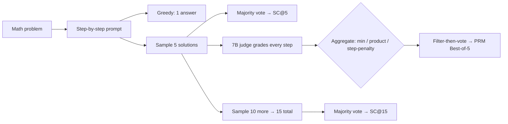
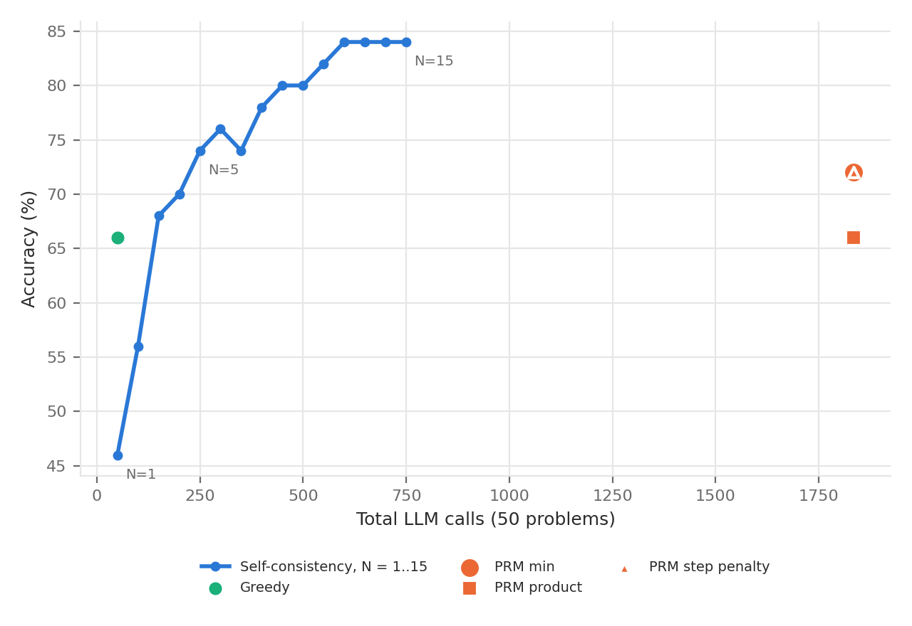
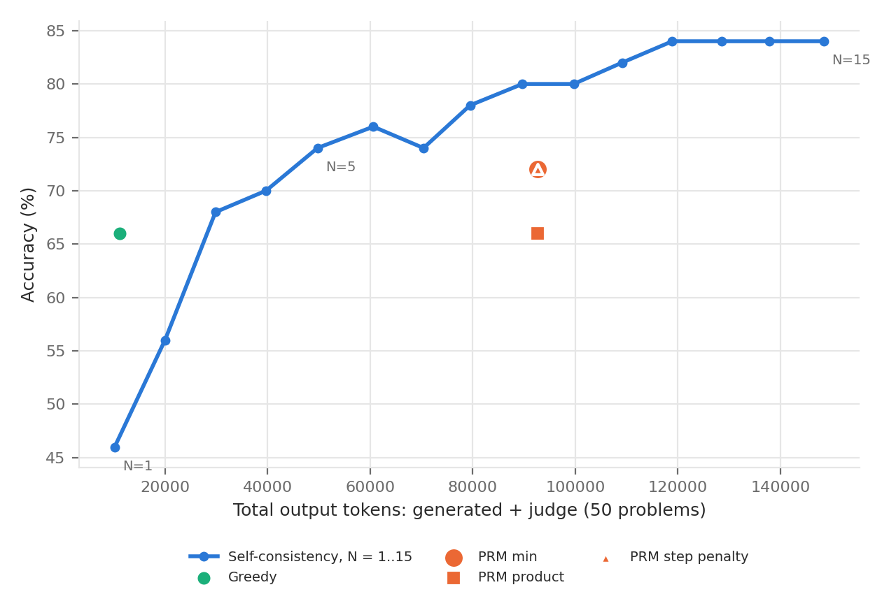

<div align="center">

# Thinking Harder Without Getting Smarter
### Search over Reasoning and Step-Level Process Reward Models

**CS 5326, Programming Assignment 3**
Hussnain Ali Murtaza · 25280069


</div>

---

## Table of Contents

1. [The question this project asks](#1-the-question-this-project-asks)
2. [Background: a short primer](#2-background-a-short-primer)
3. [What was built](#3-what-was-built)
4. [Results](#4-results)
5. [What the results teach us](#5-what-the-results-teach-us)
6. [Repository layout](#6-repository-layout)
7. [How to reproduce](#7-how-to-reproduce)
8. [Limitations](#8-limitations)
9. [Further reading](#9-further-reading)

---

## 1. The question this project asks

A language model's weights are fixed once training ends. Even so, *how* we ask the model and *what we do with its answers* can change how accurate it is by a large margin.

This project uses grade-school math word problems from the **GSM8K** benchmark to compare two ways of spending extra compute at answer time:

| Strategy | Idea in one line |
| :--- | :--- |
| **Ask many times and vote** (Self-Consistency) | Sample several independent solutions and return the answer most of them agree on. |
| **Ask many times and let a teacher grade each step** (Process Reward Model search) | Sample several solutions, have a larger model check every reasoning step, and keep the best-graded one. |

For a fixed compute budget, **which one gets more answers right?**

> **Short answer:** on this benchmark, plain voting won. Using the same amount of compute, Self-Consistency with 15 samples reached **84%**, against **72%** for step-graded search over 5 samples.

---

## 2. Background: a short primer

You don't need a machine-learning background to follow this section. Each idea builds on the one before it.

### 2.1 How a model picks its next word

A language model writes text one **token** (a word or part of a word) at a time. At each step it gives every possible next token a raw score called a **logit**. A function called **softmax** turns these scores into probabilities that add up to 1:

```
p(token_i) = exp(logit_i) / Σ_j exp(logit_j)
```

The model then has to choose one token. That choice is the **decoding strategy**.

### 2.2 Greedy decoding vs. sampling

- **Greedy decoding** always takes the most likely token. It is deterministic: the same question always gets the same answer. It works well when there is essentially one correct output, as in arithmetic.
- **Sampling** draws a token at random according to the probabilities. The output varies from run to run, which is what lets us get *different* attempts at the same problem.
- **Temperature** `T` controls how adventurous sampling is. The logits are divided by `T` before softmax:
  - `T < 1` sharpens the distribution, so sampling behaves more like greedy.
  - `T > 1` flattens it, so sampling becomes more random.

  This project uses `T = 0.7`, which gives enough variety to be useful without producing too much nonsense.
- **Truncation** methods cut off the long tail of unlikely tokens:
  - **top-k** keeps only the `k` best tokens.
  - **top-p (nucleus)** keeps the smallest set of tokens whose probabilities add up to `p`.

  Here both are switched off (`top_k = 0`, `top_p = 1.0`), so temperature is the only knob. That keeps the comparison clean, but it means an occasional very unlikely token can push a solution off course.

### 2.3 Why "showing your work" helps

The model does the same fixed amount of computation for every token it writes. A hard problem therefore can't get more "thinking" inside a single token. There are only two ways to give it more:

1. **Write more tokens.** Ask the model to reason step by step (*chain of thought*). Every intermediate line is extra computation the model gets to use.
2. **Make more calls.** Ask the same question several times and combine the answers.

Once you have several answers you need a rule to pick one. The whole field of inference-time reasoning comes down to one slogan:

> **Generate more, then select well.**

### 2.4 Self-Consistency: let the answers vote

Different correct solutions tend to reach the **same** final number. Wrong solutions tend to be wrong in **different** ways. So if you sample `N` solutions and take the most common final answer (a majority vote), random mistakes cancel out.

```
Sample 1: ... Final Answer: 18
Sample 2: ... Final Answer: 18
Sample 3: ... Final Answer: 21   ← a random slip
Sample 4: ... Final Answer: 18
Sample 5: ... Final Answer: 9    ← another, different slip
Majority vote → 18
```

### 2.5 Reward models: a second opinion

Voting only looks at final answers. A **reward model** is a separate judge that scores a solution. There are two kinds:

| | **Outcome Reward Model (ORM)** | **Process Reward Model (PRM)** |
| :--- | :--- | :--- |
| What it grades | Only the final answer | **Every reasoning step** |
| Feedback | One score per solution | One score per step |
| Analogy | A teacher who only checks the boxed answer | A teacher who marks each line of your working |

A PRM can say *"step 3 is where it went wrong"*. In theory that lets it prefer a correct solution even when the majority is wrong.

In this project the PRM is a **larger model (7B parameters) prompted to act as a strict math teacher**. It sees the problem and the earlier steps, and gives a binary verdict on the current step:

```
Verdict: VALID      → step score  +1
Verdict: INVALID    → step score  −1
```

The judge uses **local validity**: it assumes all earlier steps are correct and asks only whether *this* step follows from them. A good step should not be punished because an earlier step was wrong.

### 2.6 Turning step scores into one path score

A solution with `K` steps gets `K` scores. To rank solutions we need a single number, and the project compares three rules for combining them:

| Rule | Formula | Intuition |
| :--- | :--- | :--- |
| **min** | `min(r₁ … r_K)` | A chain is only as strong as its weakest link. |
| **product** | `∏ clamp((r_t+1)/2, 0.01, 0.99)` | The probability that every step is correct. |
| **step penalty** | `mean(r) − λ · (#invalid steps)` | Average quality, minus a fixed cost per mistake. |

When several solutions tie for the best score, a **majority vote among the tied ones** breaks the tie. This is called **filter-then-vote**.

### 2.7 A fair fight: compute matching

Grading is not free. Each judged step is one more call to a 7B model. To compare the two strategies fairly, Self-Consistency is given **as much extra sampling as PRM search spends on judging**: 15 samples instead of 5.

---

## 3. What was built

| Component | Model | Precision | Device |
| :--- | :--- | :--- | :--- |
| **Generator** (writes solutions) | Qwen2.5-1.5B-Instruct | fp16 | GPU 0 |
| **Judge / PRM** (grades steps) | Qwen2.5-7B-Instruct | 4-bit NF4 (bitsandbytes) | GPU 1 |

All six methods were run on the **same 50 GSM8K problems**, with a fixed seed per problem (`5326 + problem_index`). All PRM variants and SC@15 reuse the **same 5 sampled candidates**, so any difference comes from how answers are *selected*, not from luck in *sampling*.



**Main modules:**

- `src/extraction.py` splits a solution into steps and reliably pulls out the final integer. It handles `$1,234`, `18.00`, markdown bold and similar noise, and never crashes.
- `src/generation.py` contains the step-by-step prompt, greedy decoding, sampling and majority voting.
- `src/prm_judge.py` builds the judge prompt, parses its verdict robustly (the word `INVALID` contains `VALID`, so a careless check gets this wrong), and scores whole paths.
- `src/search.py` implements the three aggregation rules, filter-then-vote selection, PRM Best-of-N and compute-matched Self-Consistency.
- `run_all.py` is the full benchmark pipeline. It can resume after an interruption and writes every result file and plot.

---

## 4. Results

### 4.1 Accuracy and cost

| Method | Accuracy | 95% CI | LLM calls | Tokens / problem (gen + judge) | Time (s) |
| :--- | :---: | :---: | :---: | :---: | :---: |
| Greedy | 66% | 52–78 | 50 | 222 | 430 |
| Self-Consistency, N=5 | 74% | 62–86 | 250 | 994 | 571 |
| **Self-Consistency, N=15** | **84%** | **74–94** | 750 | 2,971 | 1,343 |
| PRM Best-of-5 (min) | 72% | 60–84 | 1,835 | 1,853 | 3,681 |
| PRM Best-of-5 (product) | 66% | 54–78 | 1,835 | 1,853 | 3,681 |
| PRM Best-of-5 (step penalty, λ=2) | 72% | 60–84 | 1,835 | 1,853 | 3,681 |

<p align="center">
  
  
</p>

### 4.2 Head-to-head on the same problems

| Comparison | PRM wins | SC wins | Verdict |
| :--- | :---: | :---: | :--- |
| PRM-min vs. SC@5 | 0 | 1 | No real difference |
| PRM-min vs. SC@15 | 0 | 6 | SC@15 is significantly better (sign test p ≈ 0.03) |

### 4.3 Aggregation rules compared

| Rule | Accuracy | Problems with a tie at the top |
| :--- | :---: | :---: |
| min | 72% | 84% |
| product | 66% | 46% |
| step penalty, λ = 0 / 0.5 / 2 | 74% / 72% / 72% | 70% |

### 4.4 How reliable is the judge?

In a hand audit of 30 judged steps:

| | Human: INVALID | Human: VALID |
| :--- | :---: | :---: |
| **Judge: INVALID** | 10 | 4 |
| **Judge: VALID** | 3 | 13 |

When the judge says INVALID it is right **71%** of the time (precision), and it catches **77%** of the truly invalid steps (recall).

---

## 5. What the results teach us

1. **Voting is a strong baseline.** Going from 1 sample to 15 raised accuracy from 46% to 84% without touching the model's weights. Most of the gain comes from the first few samples, and the curve levels off around N = 12.

2. **One random sample is worse than greedy (46% vs. 66%).** With truncation off, one unlucky token can derail a whole solution. Sampling is only worth it when you take *many* samples and combine them.

3. **A verifier can only choose, not fix.** PRM search picks from the same 5 candidates as SC@5. Only 4 of the 50 problems had a correct answer in the pool that voting missed, so PRM had very little room to help. In 9 problems all 5 candidates were wrong, and no amount of grading can rescue that.

4. **Binary verdicts create ties.** With scores of only ±1, most good solutions score the same. *min* ties in 84% of problems and falls back to voting, so it behaves like "Self-Consistency among the solutions the judge liked".

5. **The product rule quietly prefers short answers.** Every valid step multiplies the score by 0.99, so a 4-step solution beats a 7-step one. Short solutions are sometimes "plans" with no arithmetic in them, and the judge passes those easily.

6. **The judge has blind spots:**
   - It checks arithmetic well but misses *premise errors*. For example, "$10 buys enough wax for 20 candles" (actually only 10) was marked VALID because the division that followed was correct.
   - It sometimes punishes correct steps, such as a plain restatement of the problem or correct algebra written in LaTeX.
   - Once it has found an error it tends to mark later steps INVALID as well (58.5% vs. a 19.6% base rate), which breaks local validity.

7. **Under a fixed budget, spend it on more samples.** With 10× the tokens of greedy decoding, Self-Consistency reaches about 82%, while PRM search reaches 72% and takes almost three times as long to run.

8. **When a verifier would pay off:** a judge is most useful when it gives calibrated probabilities instead of yes/no verdicts, and when it guides generation step by step (tree or beam search) instead of reranking finished solutions.

---

## 6. Repository layout

```
.
├── src/
│   ├── extraction.py        # step parsing + final-answer extraction
│   ├── generation.py        # prompt, greedy, sampling, majority vote
│   ├── prm_judge.py         # judge prompt, verdict parsing, path scoring
│   ├── search.py            # aggregation, filter-then-vote, PRM BoN, compute-matched SC
│   └── utils.py             # model loading and decoding settings
├── data/                    # the 50-problem GSM8K subset
├── tests/                   # offline smoke tests (no GPU needed)
├── outputs/                 # every result file from the Kaggle run
│   ├── per_problem.jsonl         # full record of every problem and candidate
│   ├── results_summary.json      # main results table
│   ├── aggregation_ablation.json # min / product / step-penalty comparison
│   ├── sc_scaling_curve.json     # SC accuracy for N = 1..15
│   ├── report_stats.json         # confidence intervals, win/loss, token budgets
│   ├── judge_audit.csv           # every judged step with its rationale
│   ├── human_audit.csv           # the 30 hand-labelled steps
│   └── *.png                     # scaling plots
├── run_all.py               # end-to-end benchmark pipeline
├── kaggle_run.ipynb         # notebook used on Kaggle (2× T4)
├── submission_adapter.py    # grading interface
├── make_submission.sh       # packages the submission zip
├── REPORT.pdf               # technical report
└── REPORT.html              # editable source of the report
```

---

## 7. How to reproduce

The full run needs **two GPUs**. It was run on Kaggle with 2× Tesla T4 and took about 82 minutes.

```bash
pip install -r requirements.txt
pip install -U bitsandbytes

# 1) Offline smoke tests (CPU is fine, no models are loaded)
python tests/test_public_adapter_smoke.py

# 2) Quick format check on 10 problems
python run_all.py --check-format --limit 10

# 3) Full benchmark (writes everything to outputs/)
python run_all.py

# 4) Rebuild the summary files and plots from an existing per_problem.jsonl
python run_all.py --artifacts-only
```

Alternatively, upload the repository as a Kaggle dataset and run `kaggle_run.ipynb` with the **GPU T4 ×2** accelerator.

| Setting | Value |
| :--- | :--- |
| Seed | `5326 + problem_index` |
| Sampling | T = 0.7, top_k = 0, top_p = 1.0, repetition_penalty = 1.0, max 512 new tokens |
| Judge | greedy decoding, max 96 new tokens |
| Software | Python 3.13, torch 2.11 (CUDA 13), transformers 5.20, bitsandbytes 0.50 |

---

## 8. Limitations

- **A prompted judge is not a trained PRM.** Real process reward models learn from hundreds of thousands of human-labelled steps and output calibrated probabilities. This one is a general chat model following instructions, so it gives yes/no verdicts that depend on how the prompt is worded.
- **50 problems is a small sample.** Confidence intervals are about ±12 points wide, so small differences are not meaningful.
- **Formatting relies on the prompt alone.** About 11% of sampled solutions did not follow the `Final Answer:` format. Constrained decoding, which forbids format-breaking tokens, would remove these failures.
- **The final-answer line is never judged**, and the judge runs in 4-bit precision.

---

## 9. Further reading

- Wei et al., *Chain-of-Thought Prompting Elicits Reasoning in Large Language Models* (2022)
- Wang et al., *Self-Consistency Improves Chain of Thought Reasoning in Language Models* (2023)
- Cobbe et al., *Training Verifiers to Solve Math Word Problems* (GSM8K, 2021)
- Lightman et al., *Let's Verify Step by Step* (PRM800K, 2023)
- Snell et al., *Scaling LLM Test-Time Compute Optimally Can Be More Effective Than Scaling Model Parameters* (2024)
- Holtzman et al., *The Curious Case of Neural Text Degeneration* (nucleus sampling, 2020)

---

<div align="center">
<sub>CS 5326 · Programming Assignment 3 · Hussnain Ali Murtaza (25280069)</sub>
</div>
